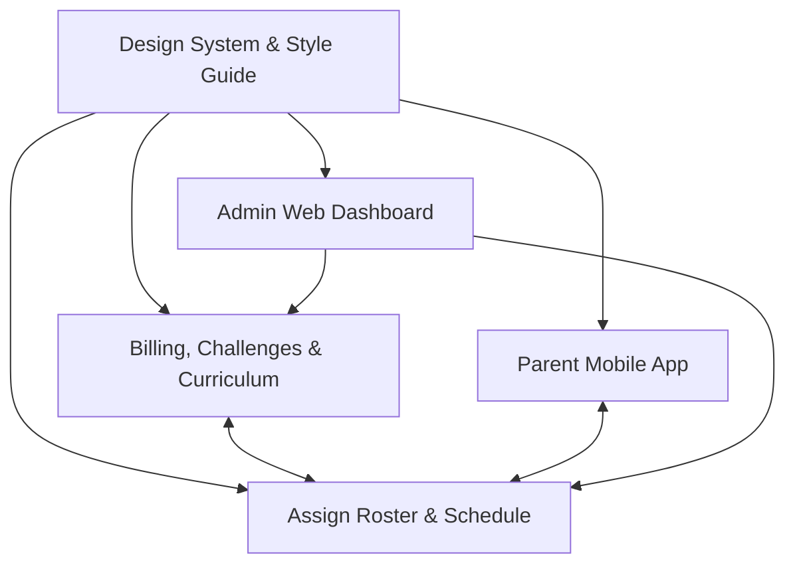

# Di Lorenzo Soccer (DSM Soccer) — System Architecture & Future Assistance Guide

> **Single Source of Truth** for the Di Lorenzo Soccer backend system, database models, business workflows, and Figma design alignment.

---

## 1. Project Context & Brand Overview

- **Project Name:** Di Lorenzo Soccer (DSM Soccer / Di Lorenzo Mindset Academy & Mentorship)
- **Founder & Head Coach:** Valentin Di Lorenzo
- **Target Audience:** Aspiring youth & academy soccer athletes, their parents, specialized performance coaches, and academy administrators.
- **Figma Design Reference:**
  - **File:** `dilorenzosoccer || Yatos application & website`
  - **File Key:** `bRJYyzZzTiJxEhT4ZTVGAf`
  - **Primary Design Node:** `13323-22257` (Player / User App Final Design)
- **Core Value Proposition:** Elite mindset coaching and tactical/technical development through structured daily habits, video action-step reviews, 3-way parent-coach communication, 4-step gamified academy challenges, and the flagship **90-Day Mentorship Program**.

---

## 2. Platform Architecture (4 Applications)



### 2.1. Player Mobile App (Athlete)

- **Onboarding & Auth:** 3-step value walkthrough, Email/Password, OTP verification, password reset.
- **Tiers:**
  - **Free Tier:** Introductory mindset & ball-mastery drills, basic streaks.
  - **Premium Tier:** Full drill library, weekly live webinars, calendar sync.
  - **90-Day Mentorship (Flagship):** Dedicated 1-on-1 coach, 3 progression phases (_Phase 1: Foundation Days 1–30_, _Phase 2: Acceleration Days 31–60_, _Phase 3: Mastery Days 61–90_), daily habit checklist, action step submissions.
- **Gamification & XP:** Daily streaks, XP points ledger, level tiers (Rookie to Elite 🏅), challenge leaderboards.
- **Community:** Private cohort/team group channels, academy announcements.

### 2.2. Parent Mobile App

- **Athlete Monitoring:** Real-time visibility into child's habit consistency, mindset journal status, and drill completions.
- **3-Way Communication:** Direct voice note, video, and text channel between Player, Parent, and Coach.
- **Calendar:** Synchronized match days, scheduled 1-on-1 coaching calls, and reminders.
- **Notifications & Billing:** Instant alerts when coaches post reviews; invoice view.

### 2.3. Coach Web Dashboard

- **Roster Overview ("My Players"):** Active athletes grid with progress bars, active tier, and day counter (e.g. _Day 12/90_).
- **Player Deep-Dive:**
  - **Feedback Tab:** Review athlete action step submissions, upload video/voice critiques, grade performance.
  - **Progress Analytics:** Habit compliance charts, session logs, XP progression.
  - **Sessions & Drills:** Assign custom ball-mastery or mental toughness drills.
  - **Group Threads:** 3-way parent-player-coach messaging.

### 2.4. Admin Web Dashboard (DSM Coach Admin)

- **Roster & Members:** Intake new athletes, assign dedicated coaches, manage parent links.
- **Coach Directory:** Track coach workload, timezone, capacity (default 10–15 athletes), and coaching specialties (_Pre-Game Routines, Mistake Recovery / Goldfish Reset, Composure Under Pressure, Confidence Conditioning_).
- **4-Step Challenge Wizard:** Step 1 (Icon, Title, Difficulty) -> Step 2 (Dates, XP Goal, Activity Checklist) -> Step 3 (Athletes & Coaches) -> Step 4 (Review & Publish).
- **Billing & Stripe:** One-off invoice issuance in **£ GBP** (e.g. £450 90-Day Mentorship admission), subscription management.
- **Master Libraries:** Reusable master drills, habits, and 90-day program templates.
- **Scheduling & Screening:** Review prospective athlete admission calls, assign reviewers.

---

## 3. Style Guide & Design Tokens

- **Brand Gold Palette:**
  - Primary Gold: `#E8A820`
  - Dark Gold / Borders: `#D99319`, `#BB7113`, `#7C4017`, `#3D1B0B`
  - Soft Cream / Accents: `#FAF0C7`, `#FCF8EA`
- **Dark Theme Palette:**
  - Deep Dark Background: `#0B0E14`, `#080B10`
  - Cards & Containers: `#131820`, `#16181C`, `#0A0A0B`
  - Inset Stroke / Border Glow: `rgba(255, 255, 255, 0.06 - 0.1)`
- **Status & Badges:**
  - Success / Completed: `#27C281` (Emerald)
  - Warning / Streak: `#FFB547` (Amber)
  - Error / Cancelled: `#FF5C5C` (Crimson)
  - Badges / Elite XP: `#8A38F5` (Purple)
- **Typography:**
  - **Headings & Display:** `Barlow Condensed` (Black 900, SemiBold 600)
  - **Body & UI:** `Inter` (Regular 400, Medium 500, Bold 700)
- **Radii:** Cards: `16px`–`24px`; Buttons: `32px` (Pill).

---

## 4. Backend Technology Stack & Directory Conventions

- **Runtime:** Node.js (Express.js)
- **Database:** MongoDB via Mongoose ODM (`v8.19.2`)
- **Authentication:** JWT (`jsonwebtoken`) + bcryptjs password hashing + OTP verification
- **Real-Time:** Socket.io (`v4.8.1`) for live notifications and 3-way messaging
- **Payments:** Stripe SDK (`stripe`)
- **Push Notifications:** Firebase Admin SDK (`firebase-admin`) FCM
- **Logging & Errors:** Winston logger + custom `ApiError` + `catchAsync` helper

### Modular Directory Structure

All domain features live under `src/modules/<ModuleName>/`:

```
src/modules/<ModuleName>/
  ├── <moduleName>.model.js       # Mongoose Schema & Model
  ├── <moduleName>.controller.js  # Request/Response Handler (wrapped in catchAsync)
  ├── <moduleName>.service.js     # Business Logic & DB queries
  └── <moduleName>.route.js       # Express Router with auth middleware
```

### Response Standard (`src/helpers/response.js`)

All controllers must respond using the standardized response helper:

```javascript
res.status(status.OK).json(
  response({
    status: "success",
    statusCode: status.OK,
    type: "User",
    message: "Operation description here",
    data: result,
  }),
);
```

---

### Static Web Portals & Dashboards (`src/app.js` & `public/`)

The Express server serves responsive web management portals backed by pure HTML/CSS/JS in `public/`:
- **`/add-coach` / `/coach-provisioning`** (Figma node `33275-4002`): Coach onboarding and specialty assignment.
- **`/add-athlete` / `/intake-athlete`** (Figma node `33275-6181`): Athlete intake and onboarding form.
- **`/assign-coach` / `/coach-assignment`** (Figma node `33275-5077`): Coach roster allocation & program phase setup.
- **`/challenges` / `/create-challenge`** (Figma nodes `33299-22507`, `33368-577`, `33384-2128`): 4-step challenge wizard.
- **`/manage-challenge`** (Figma nodes `33384-4219` to `33384-6692`): Challenge status, leaderboards, and participants.
- **`/scheduling` / `/sessions`** (Figma node `33305-3332`): 1-on-1 calls and prospective athlete admission screening.
- **`/master-libraries`** (Figma nodes `33302-24339` to `33304-3116`): Habits, video drills, reflections, and 90-day curriculum templates.
- **`/coach-dashboard`** (Figma node `33026-13150`): Coach roster overview, progress metrics, and pending reviews.
- **`/coach-player-detail`** (Figma nodes `33044-13763` to `33092-10752`): Athlete drill feedback, habit auditing, task assignment, and progress analytics.
- **`/homepage` / `/home`** (Figma nodes `32801-5982` & `32959-3560`): Athlete Homepage with real-time transition between Pre-Purchase state and Active 90-Days Mentorship program.
- **`/progress-review`** (Figma nodes `32905-2100` & `32906-2338`): Athlete personal habit compliance and streak overview.
- **`/my-dev-plan`** (Figma node `32906:2936`): Athlete personalized 90-day developmental roadmap and tactical milestones.

---

## 5. Mongoose Database Models Reference (27 Models)

All models are located under `src/modules/` and exported via standard Mongoose syntax:

### 5.1. Authentication & Users

1. **`User`** (`src/modules/User/user.model.js`):
   - **Roles:** `['user', 'athlete', 'parent', 'coach', 'admin']` (default: `'user'`)
   - **Athlete Profile:** `position`, `currentClub`, `preferredFoot`, `age`, `dob`, `gender`, `nationality`
   - **Mentorship:** `tier` (`['free', 'premium', '90-day-mentorship']`), `mentorshipPhase` (`['foundation', 'acceleration', 'mastery']`), `mentorshipDay` (1–90), `assignedCoach`, `parents`
   - **Gamification:** `xp`, `level`, `streak`, `highestStreak`, `tierBadge`
   - **Coach Profile:** `roleTitle`, `bio`, `coachingPhilosophy`, `experienceYears`, `maxAthleteCapacity` (default: 15), `operationalTimezone`, `specialties`, `isHeadCoach`
   - **Parent Profile:** `athletes` array
   - **System/Push:** `enabledPushNotification`, `fcmToken`, `stripeCustomerId`, `isBan`, `isDeleted`
2. **`OTP`** (`src/modules/Otp/otp.model.js`):
   - `sentTo`, `receiverType` (`email` / `phone`), `purpose` (`email-verification` / `forget-password`), `otp`, `expiredAt`, `status`, TTL auto-delete index.
3. **`Token`** (`src/modules/Token/token.model.js`):
   - `userId`, `passcodeToken`, `purpose` for password resets.
4. **`StaticContent`** (`src/modules/StaticContent/staticContent.model.js`):
   - Terms, Privacy Policy, About Us, Support, Cancellation Policy.

### 5.2. Mentorship, Habits & Action Steps

5. **`Habit`** (`src/modules/Habit/habit.model.js`):
   - `title`, `description`, `category` (`mindset`, `technical`, `physical`, `recovery`, `nutrition`, `tactical`), `frequency` (`daily`, `weekly`, `match-day`, `pre-training`, `custom`), `timesPerWeek`, `xpReward`, `isMasterLibrary`, `targetPhase`, `targetTier`.
6. **`HabitLog`** (`src/modules/Habit/habitLog.model.js`):
   - `athlete`, `habit`, `coach`, `date`, `status` (`completed`, `missed`, `skipped`), `notes`, `xpAwarded`. Compound index on `{ athlete, habit, date }` prevents duplicate daily completions.
7. **`ActionStep`** (`src/modules/ActionStep/actionStep.model.js`):
   - `athlete`, `coach`, `title`, `description`, `dayNumber`, `phase`, `submissionMedia` (video/audio/image URLs), `submissionNotes`, `submittedAt`, `status` (`pending`, `in-review`, `reviewed`, `needs-revision`, `approved`), `coachFeedback` (videoUrl, audioUrl, textNotes, rating, reviewedAt, reviewedBy), `xpAwarded`.

### 5.3. Training Drills, Videos & Programs

8. **`Drill`** (`src/modules/Drill/drill.model.js`):
   - `title`, `description`, `videoUrl`, `thumbnail`, `duration` (mins), `category` (`all`, `focus`, `resilience`, `confidence`, `pressure`, `mindset`, `ball-mastery`, `dribbling`, `passing`, `finishing`, `agility`, `tactical`), `difficulty` (`beginner`, `intermediate`, `advanced`, `elite`), `tierRequired`, `xpReward`, `isFeatured`, `completedBy`, `isMasterLibrary`.
9. **`VideoProgress`** (`src/modules/Train/videoProgress.model.js`):
   - `user`, `drill`, `progress` (0–100%), `isCompleted`, `lastWatchedAt`. Compound unique index on `{ user, drill }`.
10. **`Program`** (`src/modules/Program/program.model.js`):
    - `title`, `description`, `tierRequired`, `phase`, `totalDays` (e.g. 90), `schedule` array with days, drills, habits, notes, and XP totals.

### 5.4. Coaching Workflow & Task Assignments

11. **`CoachFeedback`** (`src/modules/Coach/coachFeedback.model.js`):
    - `athlete`, `coach`, `message`, `tags`, `rating` (1–5), `date`, `timeframe`.
12. **`Task`** (`src/modules/Coach/task.model.js`):
    - `athlete`, `coach`, `title`, `description`, `icon`, `category`, `xpReward`, `dueDate`, `frequency` (e.g. "Once", "Daily", "Weekdays (5×)"), `status` (`pending`, `completed`), `evidence` (`isUploaded`, `mediaUrl`, `mediaType`, `notes`, `submittedAt`), `completedAt`.
13. **`TrainingAssignment`** (`src/modules/Coach/trainingAssignment.model.js`):
    - `athlete`, `coach`, `title`, `videoUrl`, `category` (Technical, Tactical, Physical, Mental), `duration` (e.g. "15 min"), `week` (1, 2, 3), `status` (`assigned`, `in-progress`, `completed`), `completedAt`.

### 5.5. Challenges & XP Gamification

14. **`Challenge`** (`src/modules/Challenge/challenge.model.js`):
    - Matches Figma 4-step wizard: `title`, `description`, `icon` (🏆, ⚡, 🔥, 🎯, 💪, 🧠, 🏅), `difficulty`, `startDate`, `endDate`, `xpGoal` (default: 300), `activities` list, `assignedAthletes`, `status`.
15. **`ChallengeParticipant`** (`src/modules/Challenge/challengeParticipant.model.js`):
    - `challenge`, `athlete`, `earnedXp`, `completedActivities`, `isGoalReached`, `completedAt`.
16. **`XpTransaction`** (`src/modules/Xp/xpTransaction.model.js`):
    - Immutable XP ledger: `athlete`, `amount`, `source` (`habit`, `action-step`, `drill`, `challenge`, `streak-bonus`, `manual-reward`, `onboarding`), `referenceId`, `description`, `balanceAfter`.

### 5.6. Community, Cohorts & Master Libraries

17. **`CommunityPost`** (`src/modules/Community/communityPost.model.js`):
    - `author`, `authorName`, `authorEmoji`, `category` (`Focus`, `Resilience`, `Mindset`, `Achievement`, `General`), `content`, `likes` (array of Users), `likesCount`, `isMindsetWin`, `xpAwarded` (default: 20), `status` (`active`, `hidden`, `flagged`).
18. **`Group`** (`src/modules/Group/group.model.js`):
    - Cohorts, teams (e.g. "Regional Stars U18"), private groups with assigned coaches and athletes.
19. **`LibraryItem`** (`src/modules/Library/library.model.js`):
    - Reusable master templates across `contentType` (`habit`, `video-drill`, `reflection`, `curriculum` Flagship 90-Day). Includes `teachingPoints`, `questions`, `prompt`, `formType`, and phase structure.

### 5.7. Sessions, Admissions & Real-Time Messaging

20. **`Session`** (`src/modules/Session/session.model.js`):
    - 1-on-1 mentorship calls, match mentality audits, screening calls with `coach`, `athlete`, `parent`, `date`, `startTime`, `endTime`, `meetingLink`, `status`, and `calendarInviteSent`.
21. **`ChatRoom`** (`src/modules/Chat/chatRoom.model.js`):
    - 3-Way communication rooms (`type: '3-way'`) linking Coach, Athlete, and Parent, plus direct and cohort group channels.
22. **`Message`** (`src/modules/Chat/message.model.js`):
    - Messages supporting text, voice notes (with audio duration), video, images, file attachments, and read receipts.
23. **`AdmissionCall`** (`src/modules/AdmissionCall/admissionCall.model.js`):
    - Admissions screening funnel: applicant details, requested tier, booking date, assigned reviewer (Valentin Di Lorenzo), approval status.
24. **`Announcement`** (`src/modules/Announcement/announcement.model.js`):
    - Academy broadcasts filtered by target audience (`all`, `athletes`, `parents`, `coaches`, `specific-group`).
25. **`Notification`** (`src/modules/Notification/notification.model.js`):
    - Notification history for in-app inbox and Socket.io events (`habit-reminder`, `feedback-received`, `session-scheduled`, `challenge-update`, `xp-earned`, `invoice-issued`, etc.).

### 5.8. Billing & Invoicing (Stripe)

26. **`Payment`** (`src/modules/Payment/payment.model.js`):
    - One-off Stripe invoices (e.g. £450.00 GBP 90-Day Mentorship admission), status (`pending`, `paid`, `failed`, `refunded`), Stripe IDs, PDF invoices, and issuing admin.
27. **`Subscription`** (`src/modules/Payment/subscription.model.js`):
    - Recurring plan tiers (`free`, `premium-monthly`, `premium-annual`, `90-day-mentorship`), Stripe customer ID, subscription ID, period start/end, auto-renew status.

---

## 6. API Route Registry Reference

All API routes are mounted under `/api/v1` via [src/routes/index.js](file:///e:/dilorenzo/src/routes/index.js):

| Route Prefix | Module | Key Capabilities & Figma Nodes |
| :--- | :--- | :--- |
| **`/api/v1/auth`** | Auth | Register, Login, Verify OTP, Resend OTP, Forgot/Reset Password, Refresh Token |
| **`/api/v1/user`** | User | Profile, Athlete Homepage (`/homepage` node `32801:5982`), Complete Mission, Submit Feedback, Purchase 90-Days (`/purchase-90days`), Development Plan (`/dev-plan` node `32906:2936`), Habit Toggling |
| **`/api/v1/train`**<br>*(aliases: `/drills`, `/planner`)* | Train | Train Overview (`/overview` node `32772:5327`), Training Planner/Calendar (`/planner`, `/calendar` nodes `32954:2212 & 32954:2000`), Exclusive Content & Video Progress (`/exclusive-content`, `/:id/progress` node `32959:2827`), Drill Details & Completion, Coach Assignments & Evidence Upload (`/assignments/:id/evidence` node `33000:12481`) |
| **`/api/v1/coach`** | Coach | Coach Dashboard stats, Player lists, Athlete details, Action Step feedback critiques, Habit audit, Task creation |
| **`/api/v1/parent`** | Parent | Linked athlete progress overview, 3-way chat rooms, habit alerts, scheduled calls |
| **`/api/v1/challenge`** | Challenge | 4-step challenge creation, active challenges list, participant leaderboard, activity checkoffs |
| **`/api/v1/community`** | Community | Community feed, Mindset Wins, post reaction/likes, filter by category (`Focus`, `Resilience`, etc.) |
| **`/api/v1/session`**<br>*(alias: `/scheduling`)* | Session | Mentorship call scheduling, Zoom/Google Meet links, admission screening calls |
| **`/api/v1/library`**<br>*(alias: `/master-libraries`)* | Library | Master libraries CRUD for habits, video drills, reflections, and 90-day curriculum |
| **`/api/v1/static-contents`** | StaticContent | Terms, Privacy Policy, About Us, Contact & Support |

---

## 7. Implementation Roadmap for Future Assistance

When writing controllers, services, and routes for any module:

1. **Follow the established module structure:**
   - Create `<moduleName>.service.js` with business logic and database queries.
   - Create `<moduleName>.controller.js` wrapping functions with `catchAsync`.
   - Create `<moduleName>.route.js` applying `auth('athlete', 'parent', 'coach', 'admin')` as appropriate.
   - Register route inside [src/routes/index.js](file:///e:/dilorenzo/src/routes/index.js).
2. **Socket.io Integration:**
   - For chat messages, emit event `receive-message` to the `chatRoom` room.
   - For notifications, use existing [socketNotification.js](file:///e:/dilorenzo/src/socket/features/socketNotification.js) to push live alerts to `receiver`.
3. **XP Awarding Workflow:**
   - Whenever an athlete finishes a habit, action step, or drill, increment `user.xp`, recalculate `user.level`, update streak, and create an `XpTransaction` record.
4. **Stripe Invoicing & Checkout:**
   - Use the preinstalled `stripe` library with secret key from `.env` to create customers, generate invoices in `GBP`, and handle webhook events.

---

_Document created for Antigravity AI pair programming and future development assistance._
